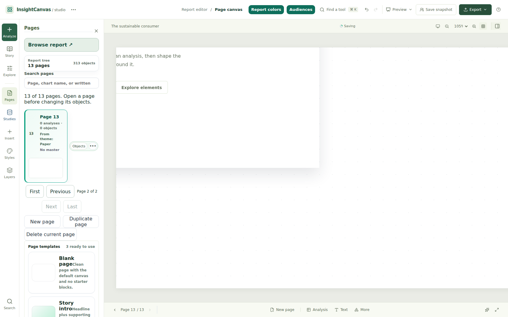
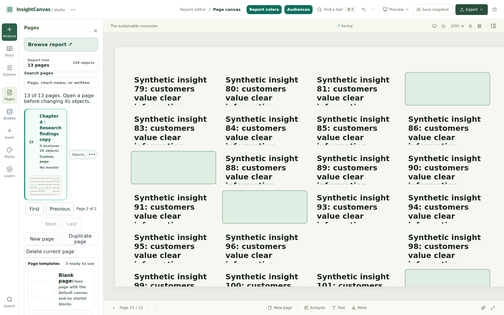

# PR #5 outline regression follow-up

The object pagination state now uses a `Map<string, number>`. IDs including `constructor`, `__proto__`, `toString` and literal `**proto**` are ordinary keys, not inherited properties. Each can open its first 25 objects, reach the remaining object(s), select the exact last object, and return to the first window without `NaN` or source mutations.

The outline initializes its page batch from the active page. It follows subsequent **active-page ID changes** within the current search results, without forcing the batch back on an unrelated rerender or a new object reference with the same active ID. Page search remains intact. Reopening a remounted Pages tree initializes to the current page; active changes while its parent is hidden also update the batch. No parent/component visibility API, report command, persistence, recovery or shared schema was changed.

## Checks run for this follow-up

- **68 tests passed in 10 focused files**, using `--maxWorkers=2 --testTimeout=20000`: all original navigator/search/outline focused files plus `ReportNavigatorOutlineRegressions.test.tsx`. Eight new cases cover the four IDs, creation, duplication, external active changes, deliberate browsing across unchanged-active rerenders, remounting and updates while hidden. Existing actual-App outline/Undo/reopen regressions were included.
- `npm run typecheck` passed. Diff whitespace and changed-path scope checks passed.
- **Actual App in Chromium 156.0.8078.4**, desktop 1680×1050, with two independent fresh synthetic browser profiles. Each starts with 12 pages, 26 authored objects per page and one imported analytical table. Both runs exercise all four IDs, finite page counts, bounded object rows, exact last-object selection and then either New page or Duplicate page. They assert page 13 is visible/current; First deliberately browses away without being overridden on an outline update; canvas Previous/Next follows across the 12/13 boundary; Layers → Pages remounts at page 13; and closing Pages, changing the active page while hidden, then reopening Pages shows the current page. The original 12 pages, imported datasets and published snapshots remain unchanged; each scenario intentionally adds one page through existing commands. No provider/external requests or page runtime errors occurred.

Browser evidence: [New page results](followup-browser-new.json), [Duplicate page results](followup-browser-duplicate.json), [check record and source hashes](followup-checks.json).





## Reproduction

From the repository root, using the same separately available Playwright and Chromium paths as the original runner:

```sh
PLAYWRIGHT_MODULE=/absolute/path/to/playwright \
CHROMIUM_EXECUTABLE=/absolute/path/to/chromium \
node docs/validation/report-navigator/verify-outline-followup.mjs

REPORT_NAVIGATOR_ACTION=duplicate \
PLAYWRIGHT_MODULE=/absolute/path/to/playwright \
CHROMIUM_EXECUTABLE=/absolute/path/to/chromium \
node docs/validation/report-navigator/verify-outline-followup.mjs
```

The runner owns its localhost:5194 server, temporary profile and entirely synthetic storage, blocks provider/external requests, and cleans up afterward. It does not use credentials or production data. The two commands isolate intentional page creation from duplication; they do not rely on browser Undo or saving/recovery behavior to reset between scenarios.

## Not tested again

The full suite, production build, original 100-page browser scale journey, narrow/200% zoom and automated accessibility-tree audit were **not rerun for this follow-up**. Their original results remain historical evidence for `e4a564f`, not a claim about the new commit. Actual screen-reader, touch, Firefox/Safari and live-provider testing remain unverified. No merge or deployment was performed.
