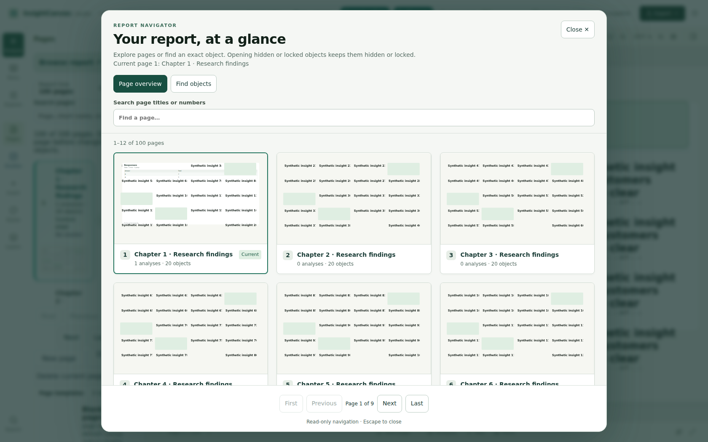
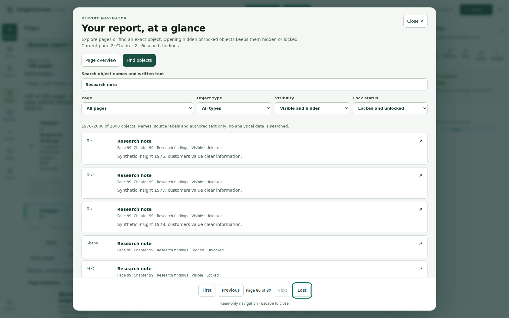
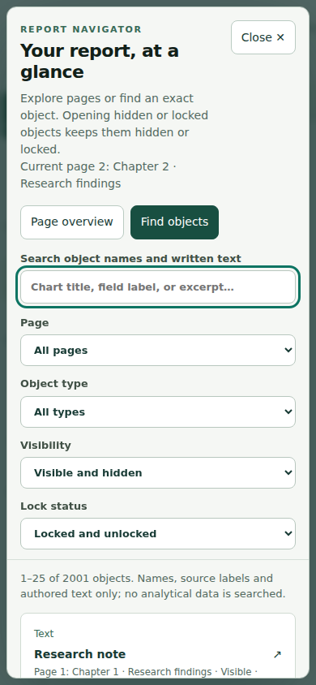
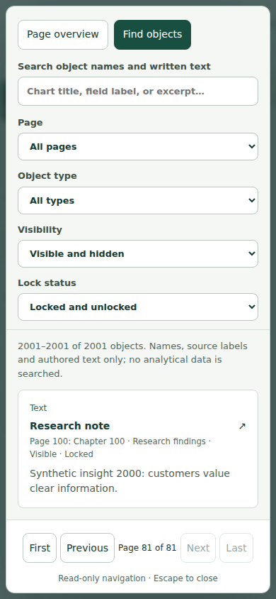
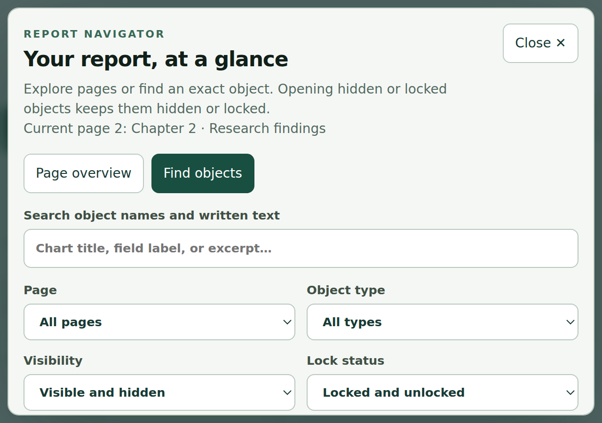
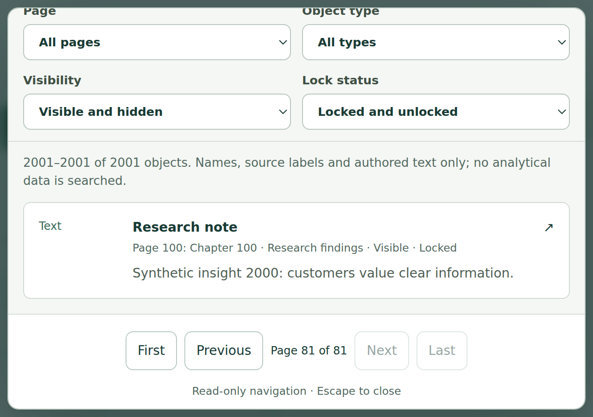

# Report navigator acceptance record

Base: `origin/codex/beta-reliability-audit` verified at `0d155ffc7919155e90036e8e90dd70533a5dfb04`. Work is isolated on `feat/report-navigator`; existing workspace changes and PRs #2–#4 are not incorporated or altered.

## Local browser reproduction

Run from the repository root with Node, installed project dependencies, Playwright available separately, and an extension-capable Chromium:

```sh
PLAYWRIGHT_MODULE=/absolute/path/to/playwright \
CHROMIUM_EXECUTABLE=/absolute/path/to/chromium \
node docs/validation/report-navigator/verify-browser.mjs
```

If Playwright and its bundled browser are installed normally, omit those two environment overrides. `REPORT_NAVIGATOR_OUTPUT` optionally selects another artifact directory. The runner starts its own local Vite server on port 5194, creates a fresh temporary browser profile and local zoom extension, seeds synthetic browser storage **before App starts**, and cleans up the server/profile afterward. All external requests and local provider/function requests are blocked and asserted absent. It reads no credentials or production data. The Chrome extension invokes `chrome.tabs.setZoom(2)` in this temporary profile only; this is actual browser zoom, not pinch scaling, device emulation or CSS zoom.

The real App uses 100 pages, 2,000 authored objects and one exact synthetic imported-data table from ten fabricated respondents. Repeated object names and Unicode/punctuation IDs are deliberate. There is one hidden shape and one locked text object per page. The browser navigates to match 21, match 2,000 and a hidden object; verifies exact selected text/outline identity; filters; scrolls to pagination at narrow width and native 200% zoom; sends canvas delete/nudge/duplicate/history keys from the dialog; checks Escape/focus trapping/restoration and retained focus at pagination boundaries; checks Chromium accessibility-tree control names; and compares the loaded draft (including results/geometry), datasets and published snapshots before and after browsing using structural equality.

## Browser evidence

See [machine-readable results](browser-results.json) and [accessible tree](accessibility-tree.txt). Timings are single local development observations, including Playwright interaction/render waits, not a benchmark or a latency guarantee. The final capture ran separately from the automated suite and production build; timings can vary with machine load and Vite compilation. No production/network timings were measured.

- Chromium 156.0.8078.4: opening the overview took 517 ms (184 ms on reopening), applying the 2,000-match query took 83 ms, and jumping to the last result window took 136 ms in the final local run.
- Mounted sidebar previews: 12; total while overview open: 24; object-browser results: 25. A separate dense-page regression bounds the original outline to 25 of 2,000 objects.
- No horizontal dialog overflow at 390×844 or at 200% native zoom. On short/narrow viewports the whole dialog scrolls, keeping every control reachable. At 200%, a 1280×900 viewport becomes 640×450 CSS pixels with device pixel ratio 2; pagination was actually clicked at this zoom.
- No unnamed exposed button/combobox/searchbox in Chromium's accessibility tree. Native keyboard interactions, Tab containment, visible focus, Escape and opener restoration were exercised. This is a targeted automated semantic/keyboard check, **not a full accessibility audit or actual screen-reader testing**.
- Browsing preserved the complete loaded draft, analytical result, source dataset and published snapshots; no provider or external requests occurred.

Screenshots were visually inspected:

| Desktop overview | Desktop object browser |
| --- | --- |
|  |  |

| Narrow controls | Narrow results/pagination |
| --- | --- |
|  |  |

| Native 200% controls | Native 200% results/pagination |
| --- | --- |
|  |  |

## Automated checks and gaps

Focused tests: 60 passed in nine files, including the existing actual-App outline/Undo/reopen regressions. Typecheck and production build passed; Vite reports a large-chunk warning. Full-suite result is recorded below after completion. Diff whitespace and forbidden-path checks are required before push.

Not verified: actual screen readers (NVDA/JAWS/VoiceOver), touch devices, Firefox/Safari, OS-specific high contrast, arbitrary malformed/unbounded documents, reports larger than the synthetic scale, production performance or live providers. The existing previews are intentionally partial thumbnails, not full-fidelity analytical exports. The pre-existing full-builder narrow layout is outside this dialog's scope. No merge, deployment, production data change, credential change, new persistence format or save/recovery change is part of this work.
